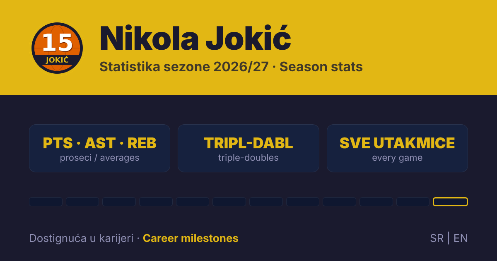

# 🏀 Nikola Jokić — Statistika sezone 2026/27



Pratim učinak Nikole Jokića (Denver Nuggets) kroz celu NBA sezonu 2026/27.
Posle svake utakmice unosim njegove brojke, a aplikacija računa proseke,
dabl-dablove i tripl-dablove i objavljuje sve na javnoj web stranici.

Ovo je moj projekat za učenje programiranja: raste tokom sezone,
a svaka izmena je zabeležena u istoriji commit-ova.

> **In English:** a season-long tracker of Nikola Jokić's 2026/27 NBA season —
> averages, double-doubles, triple-doubles, every game, and the chase for the
> all-time triple-double record. The page is available in English:
> [vladimir2709.github.io/jokic-statistika/?lang=en](https://vladimir2709.github.io/jokic-statistika/?lang=en)

## 📊 Pogledaj statistiku uživo

### 👉 [vladimir2709.github.io/jokic-statistika](https://vladimir2709.github.io/jokic-statistika/)

Stranica radi na računaru i na telefonu, bez instaliranja, na srpskom i engleskom (SR | EN).
Ažurira se posle svake utakmice.

## Šta je na stranici

- **Sledeća utakmica** sa odbrojavanjem, po vremenu posetioca (bilo gde u svetu), i naredne tri utakmice
- **Statistika sezone**: proseci poena, asistencija, skokova i minuta, bilans pobeda i poraza, dabl-dablovi i tripl-dablovi
- **Poslednja utakmica** i **sve utakmice**, sa detaljnom statistikom na klik (šut, trojke, slobodna bacanja, ukradene lopte, blokade, izgubljene lopte, faulovi, +/-)
- **Dostignuća u karijeri**: trka za NBA rekord u tripl-dablovima (Westbrook, 209) sa večnom listom, i put do 20.000 poena, 10.000 skokova i 7.000 asistencija
- **Slavlje rekorda**: kad Jokić obori rekord, posetioce dočeka zlatna zvezda i vatromet 🎆
- Anonimni brojač pregleda, bez kolačića (GoatCounter)

## Kako aplikacija radi

Podatke unosim u desktop aplikaciju napravljenu u Python-u:

- protivnik se bira iz liste svih NBA timova, pa nema grešaka u kucanju
- datum se unosi u obliku `24.10.2026`
- svako polje se proverava čim se pritisne Enter, a greška se prikazuje pored polja
- aplikacija proverava i da li se brojke slažu (npr. da poeni odgovaraju šutu i da minuti nisu veći od trajanja utakmice)
- posle svakog unosa aplikacija sama pravi novu verziju web stranice u folderu `docs/`, a stranica se objavljuje posle `git push`

## Tehnologije

- **Python 3**
- **Tkinter**, za prozor aplikacije
- **SQLite**, baza podataka u jednom fajlu
- **HTML, CSS i JavaScript**, za web stranicu
- **GitHub Pages**, za objavljivanje stranice
- **Git i GitHub**, za istoriju izmena

## Kako je nastao projekat

Kod za ovaj projekat piše AI asistent (Claude), po mojim zahtevima.
Ja osmišljavam šta aplikacija i stranica treba da rade, isprobavam svaku izmenu,
tražim ispravke kad nešto ne radi kako treba, vodim projekat kroz Git i GitHub
i posle svake utakmice unosim podatke.

Cilj mi je da kroz pravi projekat naučim kako se ideja pretvara u proizvod
koji ljudi koriste, i da korak po korak počnem da razumem i sam kod.

## Pokretanje

Ako želiš da isprobaš aplikaciju kod sebe, potreban je samo Python 3.
Tkinter i SQLite su već uključeni u njega.

```bash
git clone https://github.com/Vladimir2709/jokic-statistika.git
cd jokic-statistika
python jokic_app.py
```

Na Windows-u može i dvoklikom na `Jokic_Statistika.vbs`.

Pri prvom pokretanju aplikacija napravi praznu bazu `jokic_statistika.db`.
Moji podaci sa sezone nisu deo repozitorijuma, pa kod sebe kreneš od nule.

## Planirano

- [x] Web stranica sa statistikom (GitHub Pages)
- [x] Najave utakmica sa vremenom početka
- [x] Engleska verzija stranice
- [x] Dostignuća u karijeri i trka za rekord u tripl-dablovima
- [ ] Karijera: nagrade i ukupna statistika
- [ ] Sezonski procenti šuta i ukupni zbirovi
- [ ] Rekordi sezone i statistika po protivniku
- [ ] Tip utakmice: regularna sezona / plej-of
- [ ] Izmena već unete utakmice

## Napomena

Nezvanična stranica navijača. Nije povezana sa Nikolom Jokićem, klubom Denver Nuggets
niti NBA ligom, niti je oni podržavaju. Statistika je prikupljena iz javno dostupnih izvora.

## Feedback

Imaš ideju šta bi bilo zanimljivo pratiti, ili si našao grešku?
Otvori [Issue](https://github.com/Vladimir2709/jokic-statistika/issues).
Svaki predlog mi pomaže da unapredim projekat.

---

Autor: [Vladimir2709](https://github.com/Vladimir2709)
